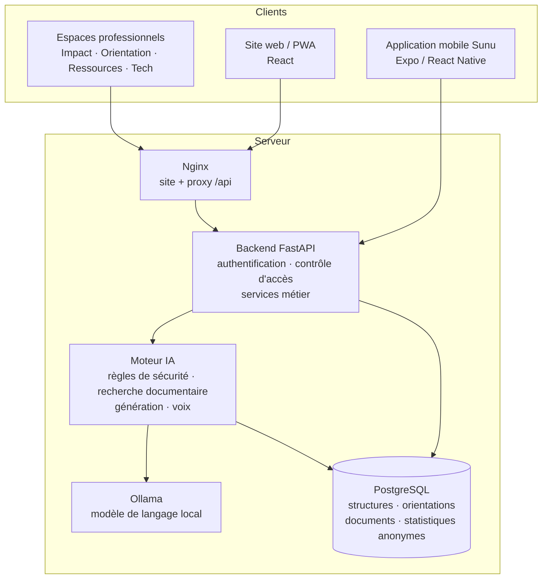
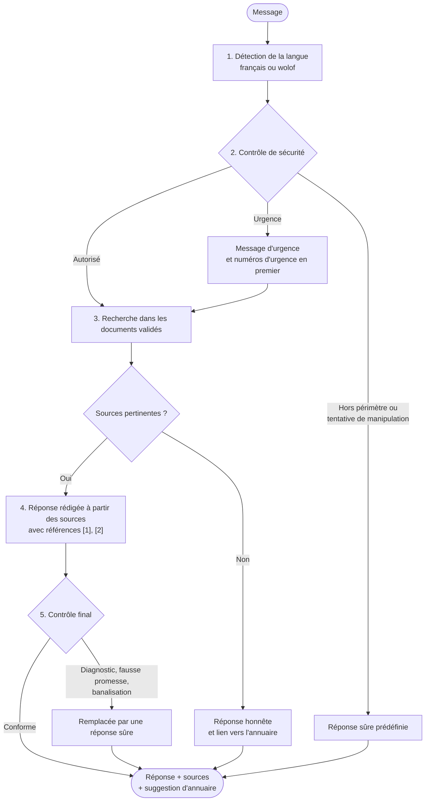
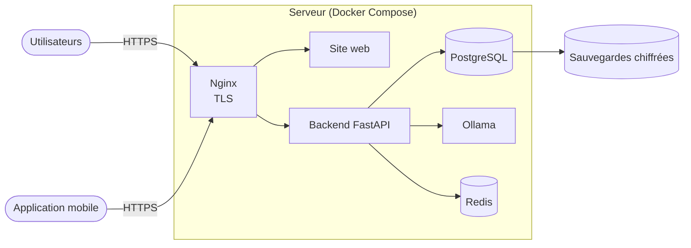

<div align="center">

# SunuSafeguard AI

**Plateforme intelligente de soutien psychosocial, d'orientation et de protection**

Écoute bienveillante en français et en wolof · Orientation vers des structures d'aide · Suivi anonyme de l'impact

Conçue par **GREEN T SARL**, Sénégal

**Français** · [English](README.md)


[](https://github.com/Dioumadev221/SUNUSAFEGUARD/actions/workflows/ci.yml)


</div>

---

## Sommaire

1. [Présentation](#présentation)
2. [Pourquoi SunuSafeguard](#pourquoi-sunusafeguard)
3. [Le concept](#le-concept)
4. [Études et conception](#études-et-conception)
5. [Fonctionnalités](#fonctionnalités)
6. [Architecture](#architecture)
7. [Fonctionnement de l'assistant](#fonctionnement-de-lassistant)
8. [Guide d'utilisation](#guide-dutilisation)
9. [Rôles et accès](#rôles-et-accès)
10. [Sécurité et confidentialité](#sécurité-et-confidentialité)
11. [Installation](#installation)
12. [Configuration](#configuration)
13. [Comptes de test](#comptes-de-test)
14. [API](#api)
15. [Développement](#développement)
16. [Résultats des essais](#résultats-des-essais)
17. [Tests](#tests)
18. [Déploiement](#déploiement)
19. [Structure du dépôt](#structure-du-dépôt)
20. [Feuille de route](#feuille-de-route)
21. [Bonnes pratiques d'exploitation](#bonnes-pratiques-dexploitation)
22. [Documentation complémentaire](#documentation-complémentaire)

---

## Présentation

Beaucoup de femmes et de jeunes filles au Sénégal font face à des violences, à de la détresse
psychologique ou à des situations d'urgence sans savoir à qui parler ni vers qui se tourner.
SunuSafeguard AI réunit, dans une seule plateforme :

- **un assistant conversationnel** disponible jour et nuit, en français et en wolof, qui écoute sans
  juger, donne des informations fiables avec leurs sources et reconnaît les situations d'urgence ;
- **un annuaire de structures d'aide** (centres d'écoute, aide juridique, hébergement, santé) avec
  une mise en relation fondée sur le consentement ;
- **des espaces professionnels** pour les structures partenaires, les expert·es des contenus, les
  institutions et l'équipe technique.

La plateforme repose sur six principes :

| Principe | Concrètement |
|---|---|
| La sécurité d'abord | Les règles d'urgence sont déterministes et passent toujours avant l'IA. |
| Aucune conversation conservée | Les messages ne sont jamais enregistrés, ni en base ni dans les journaux. |
| Ni diagnostic, ni fausse promesse | Un contrôle final remplace toute réponse qui franchirait ces limites. |
| Toujours sourcé | L'assistant ne répond qu'à partir de documents validés par des expert·es, et les cite. |
| Consentement explicite | Rien n'est transmis à une structure sans l'accord clair de la personne. |
| IA souveraine | Le modèle de langage et la reconnaissance vocale tournent en local, sans service payant. |

---

## Pourquoi SunuSafeguard

### Le problème

Au Sénégal, beaucoup de femmes, d'adolescentes et de personnes vulnérables font face à des violences
conjugales, des violences économiques, du cyberharcèlement, de la détresse psychologique ou des
situations de danger. L'aide existe (centres d'écoute, boutiques de droit, hébergement, services de
santé et sociaux), mais elle reste difficile d'accès :

- les personnes **ne savent souvent pas quelle structure peut les aider**, où elle se trouve, ni si
  elle est disponible ;
- parler de violence ou de détresse est difficile, et **la peur d'être jugée ou exposée** empêche
  beaucoup de personnes de demander ;
- l'information fiable sur les droits, la protection et le bien-être est **dispersée** et rarement
  disponible en wolof, la langue parlée au quotidien par la majorité ;
- les structures travaillent de façon cloisonnée, et les institutions **manquent de chiffres fiables**
  sur les besoins, les régions et les délais de prise en charge pour orienter leurs décisions.

### La réponse

SunuSafeguard AI est une porte d'entrée unique, accessible depuis un téléphone, à toute heure, sans
donner son nom. Elle écoute, informe à partir de sources validées, reconnaît les urgences et met la
personne en relation avec une structure humaine quand elle le souhaite. Derrière cette porte
d'entrée, elle donne au réseau de professionnel·les les outils pour garder une information fiable,
coordonner les orientations et mesurer l'impact sans jamais exposer les personnes accompagnées.

### Pour qui

| Public | Ce dont il a besoin | Ce que SunuSafeguard lui apporte |
|---|---|---|
| Femmes, adolescentes, personnes vulnérables | Un lieu sûr et discret pour parler et trouver de l'aide | Assistant en français et en wolof, annuaire, mise en relation avec consentement, sortie rapide, mode discret |
| Structures partenaires | Des demandes exploitables et une fiche à jour | Sunu Orientation : fiche, disponibilités, demandes reçues, équipe |
| Juristes, psychologues, linguistes | La maîtrise de ce que dit l'assistant | Sunu Ressources : validation des documents, tests, analyse des lacunes |
| Institutions et bailleurs | Des chiffres fiables et anonymes | Sunu Impact : indicateurs, carte des régions, rapports |
| Équipe technique GREEN T | Une plateforme fiable et sécurisée | Sunu Tech : qualité de l'IA, sécurité, audit, comptes |

### Ce que SunuSafeguard n'est pas

SunuSafeguard ne remplace ni les médecins, ni les psychologues, ni les travailleurs sociaux, ni les
autorités. La plateforme ne pose jamais de diagnostic, ne prescrit rien et ne signale jamais personne
de sa propre initiative. C'est un outil complémentaire d'information, de première orientation et
d'accès aux services humains.

---

## Le concept

### Le nom

*Sunu* signifie « notre » en wolof. *Safeguard* signifie protection. **SunuSafeguard**, c'est « notre
protection » : un outil construit au Sénégal, pour les personnes au Sénégal, avec les structures qui
les protègent déjà.

### Une plateforme, cinq espaces

| Espace | Finalité |
|---|---|
| **Espace public** (site et application mobile) | Écouter, informer, orienter. Ouvert à toutes et tous, sans compte. |
| **Sunu Impact** | Comprendre les besoins et les tendances pour éclairer les décisions institutionnelles. |
| **Sunu Orientation** | Coordonner les mises en relation avec le réseau de structures humaines. |
| **Sunu Ressources** | Garder la maîtrise de la qualité des connaissances utilisées par l'IA. |
| **Sunu Tech** | Garantir la performance, la sécurité et la fiabilité de la plateforme. |

Chaque espace a ses propres utilisateurs, permissions et données. Ils partagent un même socle
technique et une même identité visuelle.

### Principes de conception

| Principe | Ce qu'il signifie dans SunuSafeguard |
|---|---|
| Sécurité dès la conception | Chaque parcours est pensé pour la sécurité de la personne : sortie rapide, mode discret, règles d'urgence prioritaires. |
| Confidentialité dès la conception | Minimisation des données : aucune conversation conservée, aucun compte obligatoire, statistiques anonymes uniquement. |
| IA centrée sur l'humain | L'IA accompagne les personnes et les professionnel·les sans remplacer leur jugement. |
| Humain dans la boucle | Les situations qui demandent une personne sont orientées vers des structures humaines, avec consentement. |
| Connaissances validées | Les réponses reposent sur des documents validés par des expert·es, avec leurs sources. |
| Inclusion numérique | Mobile d'abord, langage simple, français et wolof, saisie vocale, fonctionne avec une connexion faible. |
| Redevabilité | Chaque action d'administration est tracée dans un journal d'audit. |

---

## Études et conception

### Documents de référence

La plateforme a été conçue à partir de deux cahiers des charges rédigés pour le projet :

| Document | Contenu |
|---|---|
| **Cahier des charges fonctionnel et technique** (19 chapitres) | Contexte et vision, les quatre tableaux de bord vue par vue, l'espace public, rôles et permissions, architecture IA et RAG, architecture multilingue, modèle de données, sécurité et protection des personnes, exigences non fonctionnelles, API, critères de recette, gouvernance |
| **Cahier des charges de l'application mobile** | Les cinq espaces mobiles (Écoute, Réponse, Ressources, Session, Discret), règles de confidentialité sur le téléphone, voix, usage hors connexion |

Chaque exigence de ces documents est tracée dans le code et la documentation (les références de type
« CDC §9.2 » dans le code renvoient au chapitre correspondant).

### Choix de conception et leurs raisons

| Choix | Raison |
|---|---|
| **Aucun compte nécessaire** pour utiliser l'assistant ou l'annuaire | Une personne en danger doit pouvoir demander de l'aide sans laisser d'identité. Le compte est facultatif, seulement pour suivre ses demandes depuis plusieurs appareils. |
| **Aucune conversation conservée** | Protège les personnes si un appareil ou le serveur était compromis, et installe la confiance. |
| **Règles d'urgence déterministes** avant l'IA | Une urgence ne doit jamais dépendre de l'humeur d'un modèle de langage. Les règles sont prévisibles et testables. |
| **Réponses uniquement à partir de documents validés** | Évite toute information inventée sur des sujets sensibles comme le droit, la santé et les violences. |
| **IA locale et open source** (Ollama, Whisper) | Aucun service payant, aucun message envoyé à un fournisseur étranger, maîtrise complète des données. |
| **Repli par extraits** | L'assistant continue de fonctionner même si le modèle de langage s'arrête. |
| **Sortie rapide et mode discret** | Une personne peut être surveillée. Un geste efface la conversation et ferme l'application ou l'onglet. |
| **Consentement avant orientation, coordonnées chiffrées** | La personne garde la maîtrise de ce qui est transmis, à qui et pour combien de temps. |
| **Seuil de publication N ≥ 5** | Empêche d'identifier quelqu'un à travers les statistiques d'une petite région. |
| **Permissions contrôlées par le serveur** | La sécurité ne peut pas dépendre de ce qu'affiche l'interface. |

### Identité visuelle

La charte « Teranga » (du nom de la valeur sénégalaise d'hospitalité) vise un lieu sûr, accueillant
et institutionnel :

- une palette bleu nuit, sable chaud et sarcelle, avec l'ocre pour la chaleur et le rouge réservé
  **uniquement** à la sortie rapide et aux numéros d'urgence ;
- Fraunces pour les titres et Plus Jakarta Sans pour le texte, embarquées pour ne charger aucune
  ressource tierce ;
- un logo représentant un cœur où le soleil se lève sur la mer, et des arches évoquant la porte d'une
  maison (*kër*) ;
- le mode sombre par défaut, plus discret sur un téléphone.

La charte complète se trouve dans [`docs/user-guides/charte-ui.md`](docs/user-guides/charte-ui.md).

### Contenus et annuaire

- La base de connaissances couvre l'écoute psychosociale, les violences conjugales et les droits, le
  cyberharcèlement, les violences économiques, l'hébergement, la santé reproductive, le stress, le
  soutien à un proche, les idées suicidaires, les ressources au Sénégal et la confidentialité.
- L'annuaire comprend de vraies structures sénégalaises, dont l'AJS Grand-Yoff, la Maison Rose
  (Guédiawaye), La Palabre (Thiès), le CLVF (Kédougou) et le CEGID. Leurs coordonnées sont vérifiées
  auprès de chaque structure avant leur raccordement au service de mise en relation.

### Gouvernance

| Domaine | Responsabilité |
|---|---|
| Architecture et développement | GREEN T SARL |
| Infrastructure et cybersécurité | Équipe technique GREEN T |
| Gouvernance des contenus | Expert·es habilité·es |
| Validation psychosociale | Professionnel·les compétent·es |
| Validation juridique | Expert·es juridiques |
| Validation linguistique | Spécialistes du français et du wolof |
| Fiches des structures | Structures partenaires |
| Protection des personnes | Responsables et professionnel·les habilité·es |

---

## Fonctionnalités

| Composant | Ce qu'il apporte |
|---|---|
| **Site public** | Assistant conversationnel (français / wolof), annuaire des structures, mise en relation avec consentement, suivi par code, page confidentialité, bouton Sortie rapide, installable sur téléphone (PWA) |
| **Application mobile « Sunu »** | Application Android et iOS avec saisie vocale, réponses, ressources, suivi des demandes et sortie rapide en un geste |
| **Sunu Impact** | Indicateurs anonymes, évolution, besoins, langues, carte des régions, rapports PDF et Excel |
| **Sunu Orientation** | Fiches des structures, disponibilités, demandes de mise en relation reçues, délais, gestion d'équipe |
| **Sunu Ressources** | Import de documents, circuit de validation par les expert·es, publication, test de l'assistant, évaluation |
| **Sunu Tech** | Qualité et performances de l'IA, état des services, événements de sécurité, journal d'audit, comptes, purge des données |
| **Sécurité** | Contrôle d'accès par rôle appliqué par le serveur, double authentification, verrouillage des comptes, limitation de débit, chiffrement des données d'orientation, purge automatique |
| **Reconnaissance vocale** | Modèles Whisper locaux pour le français et le wolof ; l'audio n'est jamais écrit sur le disque |

---

## Architecture



| Composant | Rôle | Emplacement |
|---|---|---|
| Site web | Interface publique et espaces professionnels | `frontend/` |
| Application mobile | Application Android / iOS branchée sur la même API | `frontend/mobile/` |
| Backend | API REST, authentification, permissions, logique métier | `backend/` |
| Moteur IA | Détection de langue, règles de sécurité, recherche documentaire, génération, reconnaissance vocale | `ai-engine/` |
| Modèle de langage | Serveur Ollama local (`qwen2.5:3b` pour les réponses, `paraphrase-multilingual` pour la recherche) | service externe |
| Base de données | PostgreSQL en production, SQLite en développement local | `backend/migrations/` |

Le contrôle d'accès est toujours appliqué par l'API : l'interface masque ce qu'un compte n'a pas le
droit de voir, et le serveur refuse toute requête non autorisée.

---

## Fonctionnement de l'assistant

Chaque message passe par la même chaîne de contrôles avant qu'une réponse ne s'affiche.



| Étape | Ce qui se passe |
|---|---|
| Détection de la langue | Le message est identifié comme français ou wolof. Les questions en wolof sont enrichies grâce à un lexique pour améliorer la recherche. |
| Contrôle de sécurité | Des règles déterministes détectent les urgences (y compris quand une autre personne est en danger), les tentatives de manipulation, les demandes hors périmètre et les demandes de diagnostic. L'urgence passe toujours en premier. |
| Recherche documentaire | Recherche hybride : 75 % sens, 25 % mots-clés. Seuls les documents **publiés** par les expert·es sont utilisés. |
| Réponse | Le modèle local rédige une réponse à partir des sources trouvées. Si le modèle est indisponible, l'assistant répond avec des extraits des documents : il ne s'arrête jamais. |
| Contrôle final | Toute réponse qui poserait un diagnostic, promettrait une confidentialité absolue, banaliserait une violence ou annoncerait un signalement est remplacée. |

Le texte des messages n'est jamais enregistré. Seules des statistiques anonymes sont conservées :
langue, catégorie de besoin, région déclarée, canal et heure arrondie.

---

## Guide d'utilisation

### Pour les personnes qui cherchent de l'aide (site web)

**Parler à l'assistant**

1. Ouvrir le site et cliquer sur **« Essayer maintenant »**, ou aller sur la page de l'assistant.
2. Écrire son message en français ou en wolof. Aucun nom ni aucune information personnelle n'est demandé.
3. Lire la réponse et ses sources. En cas d'urgence, les numéros d'urgence s'affichent en haut.
4. La conversation n'est gardée que dans le navigateur et disparaît à la fermeture de l'onglet.

**Trouver une structure**

1. Ouvrir l'annuaire (**« Voir les structures »**).
2. Filtrer par région (**« Toutes les régions »**) et par besoin (**« Type de besoin »**).
3. Ouvrir une structure pour voir ses services, horaires, modalités d'accès et disponibilités.
4. Utiliser **« Appeler »** pour la contacter directement.

**Demander à être recontactée par une structure**

1. Sur la fiche d'une structure, choisir **« Être rappelée »**. Ce bouton apparaît pour les
   structures qui reçoivent les demandes via la plateforme.
2. Lire ce qui sera transmis, indiquer un moyen sûr de vous recontacter et donner votre consentement.
3. Cliquer sur **« Transmettre »**. Un code de suivi de la forme `SSG-XXXXXXXX` s'affiche : le garder.
4. Plus tard, utiliser **« Suivre avec votre code »** pour voir l'avancement de la demande.

**Quitter rapidement**

Le bouton rouge **Sortie rapide** est présent sur chaque page. On peut aussi appuyer **deux fois sur
Échap**. La conversation est effacée et la page est remplacée par un site neutre, sans laisser de trace
dans l'historique du navigateur.

### Pour les personnes qui cherchent de l'aide (application mobile « Sunu »)

| Écran | Utilisation |
|---|---|
| **Accueil** | Accès à l'assistant, à l'annuaire, aux sujets et aux numéros d'urgence. |
| **Sunu Écoute** | Appuyer sur le micro, parler en français ou en wolof, relire le texte reconnu, puis l'envoyer. |
| **Sunu Ressources** | Chercher dans l'annuaire par région, département ou besoin ; appeler une structure ; l'annuaire fonctionne aussi hors connexion. |
| **Mise en relation** | Choisir ce qui est transmis, donner son consentement, recevoir un code de suivi. |
| **Sunu Session** | Suivre ses demandes, et utiliser **« Effacer toute trace »** pour supprimer tout ce qui est gardé sur le téléphone. |
| **Sortie rapide** | Le bouton **« Sortir »** efface la conversation et ferme l'application. Sur iPhone, où une application ne peut pas se fermer seule, l'écran devient noir et vide ; un toucher ramène à l'accueil. |

### Pour les professionnel·les

**Se connecter**

1. Aller sur la page **« Espace pro »** (`/pro`) et se connecter avec son e-mail professionnel et son
   mot de passe.
2. Si la double authentification est activée sur le compte, saisir le code à 6 chiffres de
   l'application d'authentification.
3. À la première connexion avec un mot de passe provisoire, choisir un nouveau mot de passe.
4. Seuls les espaces autorisés par le rôle sont visibles. Se déconnecter avec **« Se déconnecter »**.

**Activer la double authentification** (obligatoire pour les super administrateurs et les administrateurs techniques)

1. Ouvrir **« Mon compte »**, rubrique **« Double authentification »**.
2. Cliquer sur **« Configurer »** et scanner le QR code avec une application d'authentification
   (Google Authenticator, Microsoft Authenticator, etc.).
3. Saisir le code affiché par l'application et cliquer sur **« Activer »**.

**Gérer l'annuaire et les orientations** (Sunu Orientation)

| Tâche | Procédure |
|---|---|
| Ajouter une structure | **« Nouvelle structure »** → renseigner nom, région, département, contact, services, horaires → **« Enregistrer »**. Une nouvelle structure reste invisible du public tant qu'elle n'est pas validée. |
| Valider une structure | Ouvrir la structure → **« Valider »**. Elle apparaît alors dans l'annuaire public. |
| Mettre à jour les disponibilités | Ouvrir la structure → indiquer la disponibilité et le nombre de places → enregistrer. Chaque changement est conservé dans l'historique. |
| Traiter une demande | Ouvrir la liste des demandes → ouvrir une demande → faire évoluer son statut étape par étape (reçue, en cours, prise en charge confirmée ou non, clôturée). La personne voit chaque mise à jour avec son code de suivi. |
| Surveiller les délais | Le tableau de bord affiche les délais médians et alerte sur les demandes non reçues après 24 heures. |

**Gérer les connaissances de l'assistant** (Sunu Ressources)

1. Cliquer sur **« Importer un document »**, choisir un fichier PDF, DOCX, TXT ou MD (10 Mo
   maximum), renseigner titre, catégorie, langue et organisme source, puis **« Importer et indexer »**.
2. Le document passe par les étapes de relecture : à vérifier, en validation, validé.
3. Une fois **publié**, il est immédiatement utilisé par l'assistant. Un document non publié n'est
   jamais utilisé.
4. Utiliser l'espace de test (**« Tester »**) pour poser une question et voir les extraits que
   l'assistant utiliserait.
5. Utiliser **« Lancer l'évaluation »** pour mesurer la qualité de la recherche sur le jeu de
   questions de référence, et la vue des lacunes pour repérer les sujets que les documents ne
   couvrent pas.

**Suivre l'impact** (Sunu Impact)

1. Choisir la période et la granularité pour voir les interactions, besoins, langues, canaux et la
   carte des régions.
2. Cliquer sur **« Générer un rapport d'impact »**, puis télécharger le **« Rapport PDF »** ou les
   **« Données Excel »**.
3. Tout chiffre portant sur moins de 5 cas est masqué pour protéger l'anonymat.

**Superviser la plateforme** (Sunu Tech)

| Tâche | Procédure |
|---|---|
| Vérifier l'état des services | **« État des services »** : base de données, moteur IA, reconnaissance vocale, processeur et mémoire. |
| Vérifier le moteur IA | Voir le mode (hybride ou lexical), le modèle, le seuil de pertinence et les temps de réponse. **« Reconnecter »** relance la connexion au modèle de langage. |
| Contrôler la sécurité | Escalades d'urgence, tentatives de manipulation, échecs de connexion, comptes verrouillés. |
| Consulter le journal | **« Journal d'administration »** liste chaque action d'administration. |
| Purger les données | **« Lancer la purge maintenant »** applique immédiatement la politique de conservation (elle s'exécute aussi automatiquement toutes les 24 heures). |

**Gérer les comptes** (super administrateur, ou responsable partenaire pour sa propre équipe)

1. Ouvrir **« Comptes & accès »** (ou **« Équipe & comptes »** pour un responsable partenaire).
2. Saisir le nom complet, l'e-mail professionnel et le rôle, puis **« Créer le compte »**. Un mot de
   passe provisoire s'affiche une seule fois : le transmettre à la personne par un canal sûr.
3. Utiliser **« Désactiver »** / **« Réactiver »** pour suspendre ou rétablir un accès, et l'action de
   réinitialisation pour générer un nouveau mot de passe provisoire.

---

## Rôles et accès

La plateforme s'articule autour de trois profils principaux :

| Profil | Rôle | Accès |
|---|---|---|
| **Utilisateur** | `utilisateur` | Assistant, annuaire, ses propres demandes. Créé par inscription publique. Aucun accès aux espaces professionnels. |
| **Administrateur opérationnel** | `admin_operationnel` | Sunu Impact, Sunu Orientation et Sunu Ressources, pour toutes les structures. Ni gestion des comptes, ni supervision technique. |
| **Super administrateur GREEN T** | `super_admin` | Accès complet : tous les espaces, comptes et rôles, configuration technique, supervision. |

Des rôles plus fins sont également disponibles :

| Rôle | Espace |
|---|---|
| Administrateur technique (`admin_technique`) | Sunu Tech |
| Responsable institutionnel, Analyste | Sunu Impact |
| Responsable partenaire, Travailleur social | Sunu Orientation, limité à sa structure |
| Expert documentaire, Expert linguistique | Sunu Ressources |

La matrice complète des permissions se trouve dans
[`backend/app/core/permissions.py`](backend/app/core/permissions.py).

---

## Sécurité et confidentialité

| Engagement | Comment il est garanti |
|---|---|
| Aucune conversation conservée | Aucune table ne stocke le texte des messages ; l'historique reste dans le navigateur ou la mémoire du téléphone. |
| Statistiques anonymes | Seuls la langue, la catégorie de besoin, la région déclarée, le canal et l'heure arrondie sont enregistrés. Aucun chiffre portant sur moins de 5 cas n'est publié. |
| Consentement avant toute orientation | L'API refuse une demande de mise en relation sans consentement explicite. |
| Coordonnées protégées | Chiffrées (Fernet) et effacées dès la clôture de la demande. |
| Isolation des partenaires | Chaque structure ne voit que ses propres demandes, contrôle fait par le serveur. |
| Accès sécurisés | Mots de passe hachés, verrouillage de 15 minutes après 5 échecs, limitation de débit, double authentification pour les comptes privilégiés, révocation du jeton à la déconnexion. |
| Aucun signalement automatique | La plateforme ne contacte jamais personne à la place de la personne. |
| Conservation limitée | Purge quotidienne automatique : usage 395 jours, sécurité 180 jours, audit 730 jours, orientations 365 jours (paramétrable). |
| HTTP renforcé | `nosniff`, `X-Frame-Options: DENY`, `no-referrer`, `Cache-Control: no-store` ; aucun contenu de requête dans les journaux. |
| Discrétion sur le téléphone | Stockage local chiffré, écran masqué dans les applications récentes, captures bloquées sur Android, micro comme seule permission. |

Chacun de ces engagements est couvert par des tests automatisés (voir [Tests](#tests)).

---

## Installation

### Prérequis

| Outil | Version | Obligatoire |
|---|---|---|
| Python | 3.11 ou plus | Oui |
| Node.js | 20 ou plus | Oui |
| Ollama | récent | Recommandé. Sans lui, l'assistant répond avec des extraits des documents. |
| Docker et Docker Compose | récent | Seulement pour la pile complète |

### Installation locale (Windows)

```powershell
git clone https://github.com/Dioumadev221/SUNUSAFEGUARD.git
cd SUNUSAFEGUARD
copy .env.example .env
.\scripts\dev.ps1
```

### Installation locale (Linux, macOS, WSL)

```bash
git clone https://github.com/Dioumadev221/SUNUSAFEGUARD.git
cd SUNUSAFEGUARD
cp .env.example .env
make install     # une seule fois
make backend     # terminal 1 : API sur http://localhost:8000 (docs : /api/docs)
make frontend    # terminal 2 : site sur http://localhost:5173
```

Au premier démarrage, une base locale est créée avec des structures, documents et comptes d'exemple.

### Pile complète avec Docker

```bash
cp .env.example .env            # changer JWT_SECRET, DATA_ENCRYPTION_KEY et les mots de passe
docker compose up -d --build    # site sur http://localhost:8080
```

Cette commande démarre le site, l'API, PostgreSQL, Redis et Ollama. Ajouter
`docker compose --profile monitoring up -d` pour Prometheus (port 9090) et Grafana (port 3000).

### Activer le modèle de langage

1. Installer Ollama (Windows : `winget install Ollama.Ollama`).
2. Démarrer le backend. Les modèles nécessaires (`qwen2.5:3b`, environ 2 Go, et
   `paraphrase-multilingual`, environ 0,6 Go) sont téléchargés automatiquement en arrière-plan.
3. Vérifier l'état avec `python -m app.cli ai-status` depuis le dossier `backend/`, ou dans Sunu Tech.

### Activer la reconnaissance vocale (optionnel)

```bash
cd backend
pip install --index-url https://download.pytorch.org/whl/cpu torch
pip install -r requirements-voice.txt
```

Les modèles Whisper (environ 1 Go) sont téléchargés à la première utilisation.

### Lancer l'application mobile

```powershell
.\scripts\dev-mobile.ps1
```

Ouvrir ensuite l'application Expo Go sur un téléphone connecté au même Wi-Fi. La fabrication d'un
APK Android est décrite dans [`frontend/mobile/README.md`](frontend/mobile/README.md).

### Commandes utiles

| Commande | Effet |
|---|---|
| `make test` | Lance tous les tests du backend et de l'IA, puis vérifie le code du site |
| `make eval` | Mesure la qualité de la recherche sur le jeu de questions de référence |
| `make seed` | Recharge les données d'exemple |
| `python -m app.cli import-orgs <fichier> --hide-demo` | Importe des structures réelles et masque les structures d'exemple |

---

## Configuration

La configuration passe par des variables d'environnement dans le fichier `.env` (modèle :
[`.env.example`](.env.example)). Le fichier `.env` ne doit jamais être commité.

| Variable | Valeur par défaut | Rôle |
|---|---|---|
| `ENVIRONMENT` | `development` | `development` crée automatiquement les tables et les données d'exemple |
| `DATABASE_URL` | SQLite local | Adresse PostgreSQL en production |
| `JWT_SECRET` | à changer | Secret de signature des sessions |
| `DATA_ENCRYPTION_KEY` | vide | Clé de chiffrement des coordonnées des demandes |
| `OLLAMA_URL` | `http://127.0.0.1:11434` | Adresse du serveur de modèle de langage |
| `OLLAMA_MODEL` | `qwen2.5:3b` | Modèle qui rédige les réponses |
| `EMBEDDING_MODEL` | `paraphrase-multilingual` | Modèle utilisé pour la recherche |
| `K_ANONYMITY_THRESHOLD` | `5` | Nombre minimal de cas avant publication d'un chiffre |
| `RETENTION_*_DAYS` | 395 / 180 / 730 / 365 | Durées de conservation |
| `RATE_LIMIT_CHAT`, `RATE_LIMIT_LOGIN` | `30/60`, `10/60` | Requêtes autorisées par fenêtre de temps |
| `REFERRAL_ALERT_HOURS` | `24` | Délai avant alerte de non-réception |

Générer une clé de chiffrement :

```bash
python -c "from cryptography.fernet import Fernet; print(Fernet.generate_key().decode())"
```

---

## Comptes de test

Ces comptes sont créés automatiquement dans les environnements de développement et de test. Mot de
passe commun : `SunuDemo2026!` (variable `DEMO_PASSWORD`).

| E-mail | Profil |
|---|---|
| `superadmin@sunusafeguard.local` | Super administrateur GREEN T |
| `operationnel@sunusafeguard.local` | Administrateur opérationnel |
| `utilisateur@sunusafeguard.local` | Utilisateur |
| `utilisateur2@sunusafeguard.local` | Utilisateur |
| `tech@sunusafeguard.local` | Administrateur technique |
| `impact@sunusafeguard.local`, `analyste@sunusafeguard.local` | Responsable institutionnel, Analyste |
| `partenaire@sunusafeguard.local`, `social@sunusafeguard.local` | Responsable partenaire, Travailleuse sociale |
| `expert@sunusafeguard.local`, `linguiste@sunusafeguard.local` | Expert documentaire, Expert linguistique |

---

## API

La documentation interactive complète est disponible sur **http://localhost:8000/api/docs**.

| Famille | Routes principales | Accès |
|---|---|---|
| Authentification | `POST /api/auth/login`, `/register`, `/logout`, `/mfa/verify`, `GET /api/auth/me` | public / connecté |
| Assistant | `POST /api/chat`, `GET /api/emergency-contacts` | public |
| Voix | `POST /api/voice/transcribe` | public |
| Annuaire | `GET /api/directory`, `POST` / `PUT /api/directory`, `POST /api/directory/{id}/availability` | public / structures |
| Orientations | `POST /api/referrals`, `GET /api/referrals/status/{code}`, `GET /api/referrals/mine`, `PATCH /api/referrals/{id}` | public / utilisateur / structure |
| Connaissances | `GET` / `POST /api/knowledge/documents`, `PATCH /api/knowledge/documents/{id}/status` | expert·es |
| Indicateurs et rapports | `GET /api/metrics/overview`, `GET /api/reports/export` | Sunu Impact |
| Comptes | `GET` / `POST /api/users`, `PATCH /api/users/{id}` | administrateurs |
| Supervision | `GET /api/health`, `GET /api/monitoring/services`, `GET /api/audit`, `GET /metrics` | Sunu Tech |

Exemple :

```bash
curl -X POST http://localhost:8000/api/chat \
     -H "Content-Type: application/json" \
     -d '{"message": "Où puis-je trouver de l aide ?"}'
```

---

## Développement

### Les étapes de construction

| Étape | Ce qui a été livré |
|---|---|
| 1. Cahier des charges | Cahier des charges fonctionnel et technique, puis cahier des charges mobile |
| 2. Socle | Backend FastAPI, modèle de données et migrations, contrôle d'accès par rôle, site public, les quatre tableaux de bord |
| 3. Moteur IA | Détection de langue, règles de sécurité, RAG avec sources citées, modèle de langage local, contrôle final des réponses, repli par extraits |
| 4. Qualité de la recherche | Recherche hybride sémantique et par mots-clés, calibrage automatique du seuil sur un jeu de questions de référence, outils d'évaluation |
| 5. Sécurité et exploitation | Double authentification, gestion des comptes, limitation de débit, chiffrement des données d'orientation, rapports PDF et Excel, purge automatique, supervision |
| 6. Application mobile | Application Expo pour Android et iOS, même design que le site, mode discret, annuaire hors connexion, reconnaissance vocale locale en français et en wolof |
| 7. Contrôle d'accès et essais | Trois profils principaux, inscription publique, déconnexion côté serveur, essais de bout en bout sur téléphone et sur le site |

### Pratiques d'ingénierie

- **Tests automatisés** pour chaque engagement de sécurité et de confidentialité (pytest pour le
  backend et le moteur IA, Jest pour l'application mobile, vérification TypeScript pour le site).
- **Migrations de base de données versionnées** avec Alembic.
- **Permissions définies dans le code**, dans un fichier unique et auditable.
- **Configuration par variables d'environnement**, sans aucun secret dans le dépôt.
- **Environnements reproductibles** : scripts locaux pour Windows et Unix, Docker Compose pour la
  pile complète.
- **Observabilité** : métriques Prometheus, état des services, état du moteur IA et journal d'audit.

---

## Résultats des essais

Des essais de bout en bout ont été menés le 2 novembre 2026 sur l'application mobile, le site et l'API.

| N° | Essai | Résultat | Observations |
|---|---|---|---|
| 1 | Inscription et connexion | Réussi | Compte créé dans l'application, connexion automatique, déconnexion puis reconnexion. Le compte reçoit toujours le profil « Utilisateur ». |
| 2 | Parcours vocal (français) | Réussi | Question parlée transcrite mot pour mot, puis réponse sourcée. |
| 3 | Parcours écrit | Réussi | Même question écrite dans l'application et sur le site. |
| 4 | Réponse fondée sur les ressources | Réussi | La réponse cite son document source. |
| 5 | Question hors périmètre | Réussi | Aucune réponse inventée, annuaire proposé ; une demande de diagnostic est orientée vers un professionnel de santé. |
| 6 | Mise en relation avec consentement | Réussi | Annuaire, fiche, « Être rappelée », case de consentement (bouton inactif tant qu'elle n'est pas cochée), code de suivi, statut réel lu sur le serveur. Sans consentement, la demande est refusée. |
| 7 | Sécurité des rôles | Réussi | 33 contrôles d'accès sur 33 conformes, y compris par adresse directe et par appel d'API. |
| C1 | Confidentialité entre comptes | Réussi | Le compte B ne voit pas la demande du compte A ; un partenaire ne voit que les demandes de sa structure. |
| C2 | Déconnexion | Réussi | Après déconnexion, l'ancien jeton est refusé par le serveur. |
| C3 | Stabilité | Réussi | 5 questions sur 5 ont reçu une réponse, aucune erreur pendant toute la campagne. |

---
## Tests

```bash
make test    # tests du backend et du moteur IA, puis vérification du typage du site
make eval    # évaluation de la qualité de la recherche
```

Chaque push et chaque pull request lancent automatiquement ces vérifications sur GitHub Actions
([`.github/workflows/ci.yml`](.github/workflows/ci.yml)) : tests du backend et du moteur IA (pytest),
typage et build de production du site, typage et tests de l'application mobile (Jest).

| Domaine | Ce qui est vérifié |
|---|---|
| Moteur IA | Détection des urgences, détection de la langue, contrôle final des réponses, tentatives de manipulation |
| Confidentialité | Messages jamais stockés, seuil d'anonymat, consentement obligatoire, isolation des partenaires |
| Accès | Permissions par espace, inscription publique sans privilège, déconnexion, double authentification, verrouillage et limitation de débit |
| Exploitation | Rapports, purge des données, comptes |
| Mobile | Canal mobile, limites de l'API vocale, sortie rapide, conservation locale |

Qualité de la recherche sur le jeu de référence (14 questions) : **rappel@4 = 93 %**, **MRR = 0,82**.

---

## Déploiement



Liste de contrôle pour la production :

1. Définir des valeurs robustes pour `JWT_SECRET`, `DATA_ENCRYPTION_KEY` et les mots de passe de la base.
2. Définir `ENVIRONMENT=production` et `DATABASE_URL` vers l'instance PostgreSQL.
3. Servir la plateforme uniquement en HTTPS.
4. Planifier des sauvegardes chiffrées avec `infrastructure/scripts/backup-postgres.sh`.
5. Renseigner l'adresse publique de l'API dans `frontend/mobile/eas.json`, puis compiler l'application.

Détails : [docs/deployment/README.md](docs/deployment/README.md).

---

## Structure du dépôt

```text
SUNUSAFEGUARD/
├── .github/workflows/  Intégration continue (tests à chaque push et pull request)
├── ai-engine/          Moteur IA : règles de sécurité, recherche, génération, wolof, voix
├── backend/            API FastAPI, modèles de données, migrations, tests
├── frontend/           Site React (pages publiques et espaces professionnels)
│   └── mobile/         Application mobile Expo « Sunu »
├── data/
│   ├── knowledge_base/ Documents sources utilisés par l'assistant
│   ├── seed/           Comptes, structures, numéros d'urgence
│   └── evaluation/     Questions de référence pour la qualité de la recherche
├── infrastructure/     Docker, Nginx, PostgreSQL, supervision, sauvegardes
├── docs/               Architecture, API, sécurité, base de données, déploiement, guides
├── scripts/            Scripts de démarrage local
├── docker-compose.yml
├── Makefile
└── .env.example
```

---

## Feuille de route

| Version | Contenu |
|---|---|
| **1.0 (actuelle)** | Assistant français et wolof avec réponses sourcées et règles de sécurité, annuaire et mise en relation, quatre espaces professionnels, application mobile, double authentification, rapports, purge des données |
| **Prochaine version** | Expérience vocale enrichie, gestion des rôles depuis l'interface |
| **Ensuite** | Recherche vectorielle avec pgvector, déploiement multi-instances, publication sur les stores |

---

## Bonnes pratiques d'exploitation

| Domaine | Recommandation |
|---|---|
| Contenus | Faire relire régulièrement les documents de `data/knowledge_base/` par des juristes et des professionnel·les psychosociaux. |
| Numéros d'urgence | Tenir à jour `data/seed/emergency_contacts.json`. |
| Wolof | Faire valider les évolutions du lexique et des messages en wolof par des linguistes. |
| Règles de sécurité | Revoir `ai-engine/safety/rules.py` avec des professionnel·les à chaque modification. |
| Annuaire | Tenir à jour les structures, coordonnées et conventions de partenariat. |
| Données personnelles | Tenir à jour l'analyse d'impact relative à la protection des données. |
| Infrastructure | HTTPS, rotation des secrets, sauvegardes chiffrées, tests d'intrusion réguliers. |
| Mineures | Appliquer un protocole spécifique pour ce public. |

---

## Documentation complémentaire

| Document | Contenu |
|---|---|
| [Architecture](docs/architecture/README.md) | Composants et chaîne de traitement IA en détail |
| [API](docs/api/README.md) | Familles de routes et exemples |
| [Sécurité et confidentialité](docs/security/README.md) | Garanties et tests qui les vérifient |
| [Base de données](docs/database/README.md) | Schéma et migrations |
| [Déploiement](docs/deployment/README.md) | Mise en production |
| [Guide de l'application mobile](docs/user-guides/guide-app-mobile.md) | Utilisation de « Sunu » |
| [Charte graphique](docs/user-guides/charte-ui.md) | Couleurs, typographie, composants |

---

<div align="center">

**SunuSafeguard AI** · GREEN T SARL, Sénégal

*« Sunu » signifie « notre » en wolof : une plateforme pensée avec et pour les personnes qu'elle protège.*

</div>
